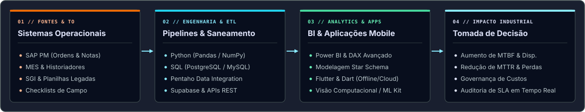
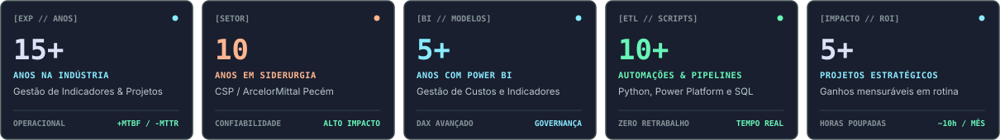
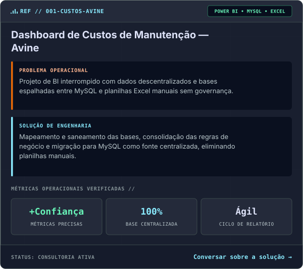
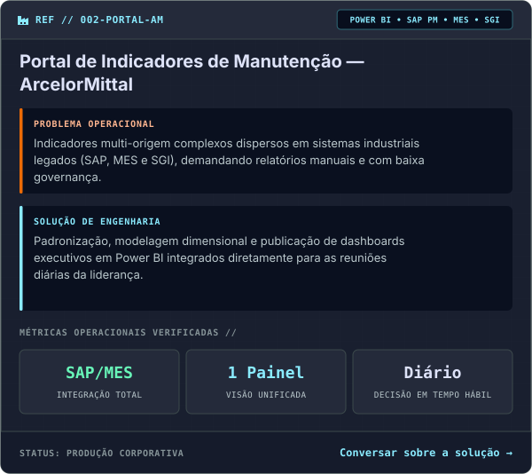
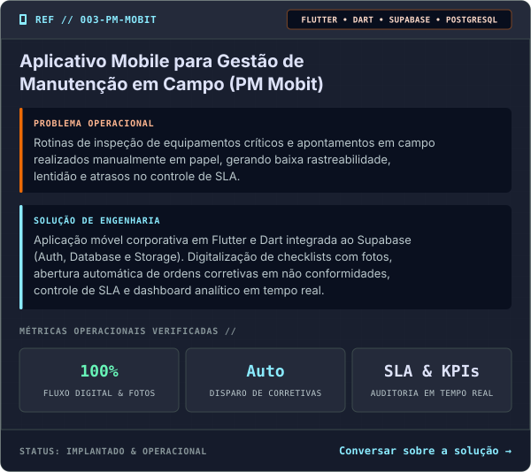
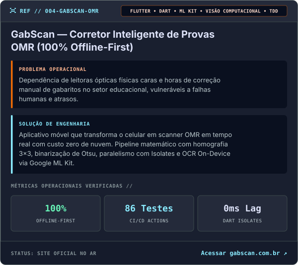
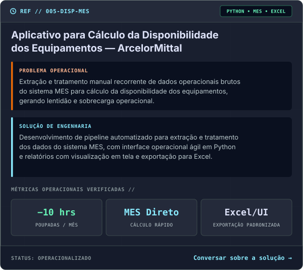
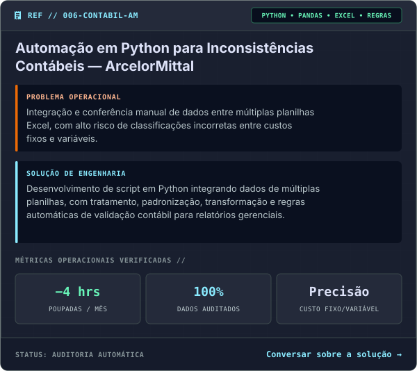

# Dione Nascimento | Especialista em Dados Industriais & Engenharia de Confiabilidade

---

### 📌 Sobre Mim

**Especialista em Dados Industriais & Engenharia de Confiabilidade**

Sou Dione Nascimento, profissional de Fortaleza/CE com **15 anos de experiência na indústria**, sendo **10 deles dedicados ao setor siderúrgico**. Graduado em Análise e Desenvolvimento de Sistemas e graduando em Engenharia de Produção, atuo na integração entre **Engenharia de Manutenção** e **Análise de Dados**, transformando registros de sistemas operacionais (SAP PM, MES, SGI) em soluções analíticas estratégicas para a redução de perdas, aumento de MTBF e governança de custos.

Sou o criador do projeto e canal no YouTube **[Portal dos Dados](https://www.youtube.com/@Portal_dos_Dados)**, onde compartilho aplicações práticas de Power BI industrial, Python, automação de rotinas e engenharia de confiabilidade de ativos.

  
  
  
  

---

### 🛠️ Stack Tecnológica & Arquitetura de Dados

  

  
  
  
  
  
  
  
  
  

---

### 📊 Telemetria & Indicadores de Carreira

  

---

### 🚀 Projetos & Soluções em Destaque

  
  

  
  

  
  

---

### 📈 Estatísticas do GitHub

  
  

 

---

### 📬 Conecte-se Comigo

  
  
  
  

